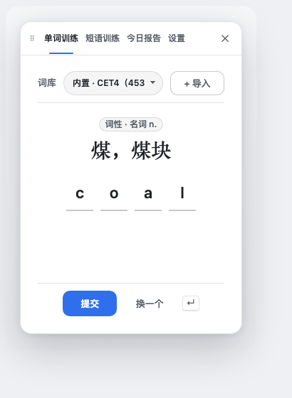
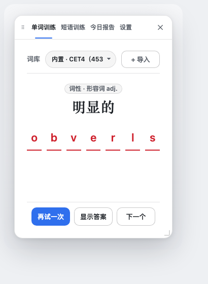
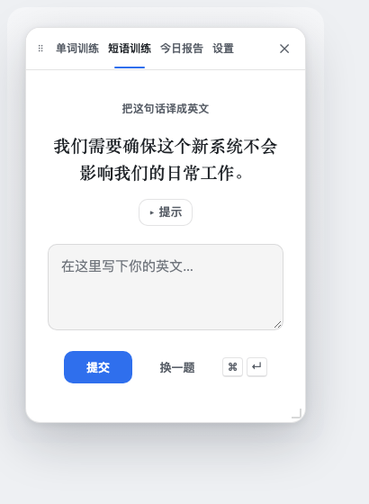
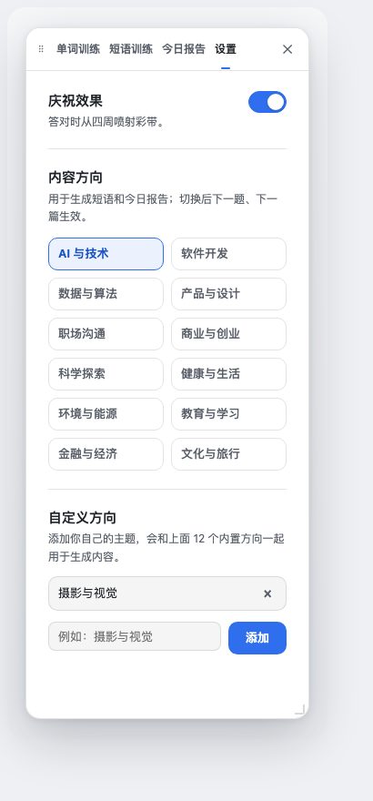

# English Gym · DSH 英语练习挂件

English Gym 是常驻在 DSH 输入框下方的一个小挂件。它不会打断你正在做的事：想练的时候点开，练完收起，继续工作。

看板是一小块浮动窗口，可以拖动、可以缩放，不会把对话内容撑开或顶上去。全程不涉及语音，只专注读和写。

## 界面截图

### 单词训练

看中文，按字母空格拼出英文单词。每个空格对应一个字母，输入时自动跳到下一格；提交后立刻知道对错。

答错时整个单词会标红，可以点「再试一次」原地重拼，也可以点「显示答案」看正确拼写，或者直接进入「下一个」。

### 短语训练

看一句中文，写出对应的英文。提交后会给出对错、参考译文和一句提示；答错的句子会进入复习队列，之后会再出现。

### 今日报告

每天一篇 180–240 词的英文短文，主题偏 AI 和技术，附带 3 道翻译小题。打开就能读，读完可以顺手练一练。

### 设置

可以开关答对时的彩带庆祝，也可以选择短语和报告的内容方向，或者添加自己的方向。

## 功能

- **单词训练**：内置 CET4、英语六级、雅思、托福四套词库，共 24120 个词条。看中文、按字母拼写，提交后立刻判对错；答错可重试、可显示答案，答对按回车就能进入下一个。
- **自定义词库**：在「单词训练」顶部点「导入」，可以从表格文件导入自己的词表，也可以直接粘贴内容。导入前会显示能识别多少条、前几条长什么样；导入后自动切换过去。
- **短语训练**：看中文写英文，按你的水平出题，提交后给对错、参考译文和提示。
- **错题复习**：答错的句子会自动收进复习队列，之后隔一段时间再考；答对后自动移出。
- **每日报告**：每天自动准备一篇英文短文，内容偏 AI 和技术，附 3 道翻译小题；也可以点「换一篇」重新生成。
- **内容方向**：内置 12 个方向——AI 与技术、软件开发、数据与算法、产品与设计、职场沟通、商业与创业、科学探索、健康与生活、环境与能源、教育与学习、金融与经济、文化与旅行。也可以添加自己的方向，短语和报告都会按选中的方向生成。
- **彩带庆祝**：答对时从看板四周喷出彩带；可以在设置里关掉。提交按钮按下时会有回弹反馈。
- **学习统计**：看板会显示连续练习天数、正确率、待复习数量和今日答题数。
- **随手收起**：点看板右上角的 ✕ 或按 Esc 收起；位置和大小会记住，下次打开还在原处。
- **记录留在本地**：练习记录只保存在你自己的电脑上，不需要注册账号，也不会上传到别的服务。
- **不做语音**：没有听力、跟读或口语评分，专注单词拼写和句子翻译。

## 安装

1. 下载本项目的压缩包并解压，得到 `dsh-english-learn` 文件夹。
2. 打开 DSH 的插件管理，选择「安装本地插件」，选中 `dsh-english-learn` 文件夹。
3. 安装完成后重启 DSH。
4. 在输入框下方看到 `English Gym`，点它就能开始练习。

不需要额外安装其他东西，也不需要单独配置。

## 使用小提示

- 第一次打开会直接进入「单词训练」；想练句子就切到「短语训练」。
- 觉得看板太小或太大，可以拖右下角调整；拖动看板空白处可以换位置。
- 想换词库，在「单词训练」顶部的词库下拉里选择；导入的词库也会出现在这里。
- 想换内容方向，打开「设置」选择即可，下一题或下一篇会用新方向生成。
