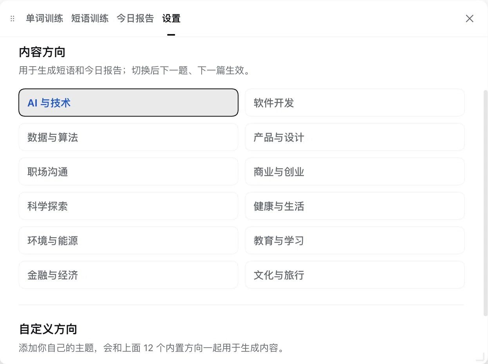

# English Gym（英语健身房）

 

English Gym（英语健身房）是常驻在 DSH（DeepSeek Harness）对话输入框下方的英语练习挂件：单词拼写、短句拼写、AI 根据会话内容生成对应训练短句；每天生成一篇英文短文，并用学习看板记录连续天数与进度。

## 功能

- 🎉**会话关联**：可在设置中开启，让短语出题结合当前会话最近的对话内容（自动脱敏），句子更贴近你手头的工作流程。
- 🎊**词库关联**：可在设置中开启，让短语出题结合当前选择的词库，句子更适合正在学习的内容。
- 📝**单词训练**：内置 CET4、英语六级、雅思、托福四套静态词库（共 24,120 词，默认 CET4）。
- 📥**自定义词库**：支持导入自己的词表（CSV / TSV / TXT / JSON），导入前可预览解析结果与报错行号，并在单词训练顶部随时切换。
- ✍️**短语训练**：由模型按设定难度（默认 CEFR B1）和内容方向出中文句子，你写英文翻译，提交后给出评分、参考译文和简短提示。答错的句子会自动进入复习队列，答对后移出。开启「词库关联」或「会话关联」后，出题会结合当前词库与最近的会话内容。
- 📰**今日报告**：每天在设定时间后自动生成一篇 180–240 词的英文短文，附带 3 道翻译小题，支持手动刷新换一篇；开启词库关联后会融入当前词库的单词。
- 📊**数据看板**：日历热力图按每天的学习活动量（单词数 + 句子数）由浅到深着色，下方按天汇总当天练过的单词和句子（默认显示前 10 个单词、前 5 句，可展开全部），顶部显示连续天数、累计单词、累计句子与学习天数。
- ⚙️**设置与统计**：面板内可切换内容方向（12 个内置方向，也支持自定义，最多 40 个）、开关答对彩带、开关词库关联并设置重试次数、开关会话关联，并展示连续天数、今日答题、正确率和待复习数。
- 🛠️**对话工具**：除浮窗面板外，主对话里也可直接调用 `english_drill` 和 `english_grade` 工具练习。

## 截图

### 单词训练

### 短语训练

### 今日报告

### 设置

## 安装

在 DSH 的「插件 → 发现」中搜索「英语健身房」即可安装；也可在插件页按包名 `dsh-english-gym` 添加。

- **npm**：https://www.npmjs.com/package/dsh-english-gym
- **GitHub**：https://github.com/KYCOMING/dsh-english-gym

## 自定义词库

「单词训练」页顶部的下拉菜单可切换词库。内置 CET4（4,535 词）、英语六级（3,990 词）、雅思（5,238 词）、托福（10,357 词）。点击「导入」可拖入文件、选择文件或直接粘贴文本，确认前会显示识别条数、样例和错误行号，导入后自动切换，且不影响内置词库。

支持格式：

- **CSV / TSV**（推荐，UTF-8，兼容 BOM）：必填 `word`（英文单词）与 `meaning`（中文释义）；可选 `pos`（词性）、`example`（英文例句）、`exampleZh`（例句翻译）。表头可省略，也兼容中文表头。
- **TXT**：每行一条，`abandon<TAB>放弃` 或 `abandon 放弃`。
- **JSON**：支持 `[{"word":"abandon","meaning":"放弃","pos":"v","example":"...","exampleZh":"..."}]`，也兼容二维数组以及 qwerty-learner 的 `{name, trans:[...]}` 格式。
- 由于采用逐字母拼写，词条须为单个英文单词（允许 `-` 和 `'`）；短语或非法行会自动跳过并在预览中提示。

## 设置

面板右上角的「设置」页：

- **庆祝效果**：开关答对时的彩带动画。
- **内容方向**：内置 12 个方向（AI 与技术、软件开发、数据与算法、产品与设计、职场沟通、商业与创业、科学探索、健康与生活、环境与能源、教育与学习、金融与经济、文化与旅行），也可添加自定义方向（最多 40 个，支持删除）。选中后，短语出题与今日报告都会按该方向生成。
- **词库关联**：开启后，短语出题与今日报告会从当前词库挑一批词，按语境自然融入句子和文章。可设置 0–5 次重试：生成内容没用到词库词时自动再试，默认 1 次。
- **会话关联**：开启后，短语出题会读取当前会话最近几轮对话，自动清理代码块 / URL / 路径 / 密钥等，只保留一段脱敏的自然语言摘录作为语境，让句子更贴近你手头的工作。默认关闭。

## License

MIT。内置词库基于 [KyleBing/english-vocabulary](https://github.com/KyleBing/english-vocabulary) 的 CET4、英语六级、雅思和托福词表（BSD-3-Clause），例句与中文翻译由本项目生成，详见 [THIRD-PARTY-NOTICES.md](THIRD-PARTY-NOTICES.md)。

---

